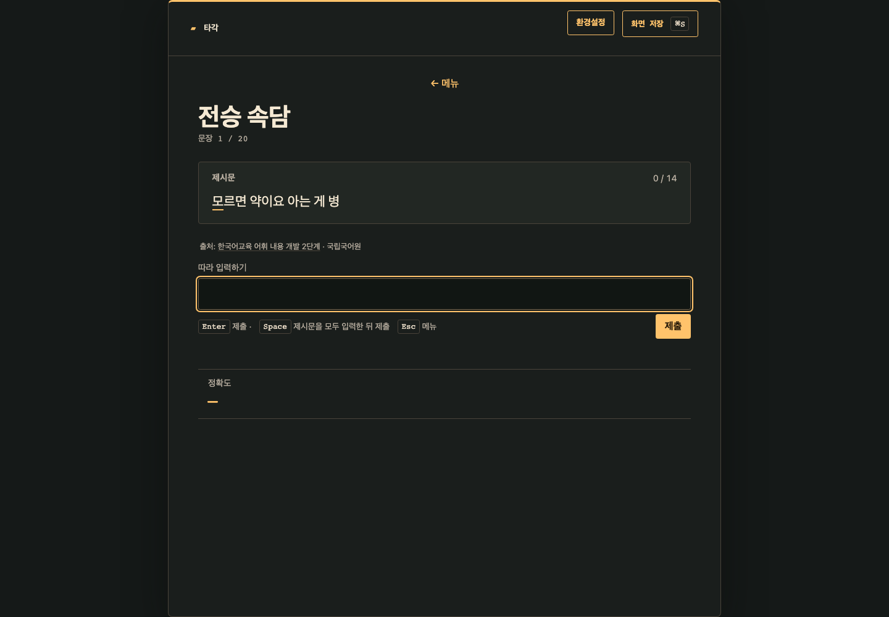
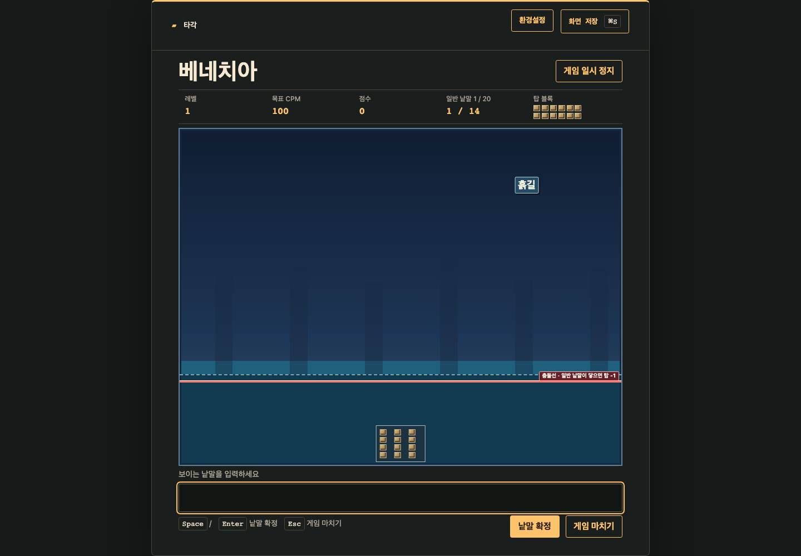
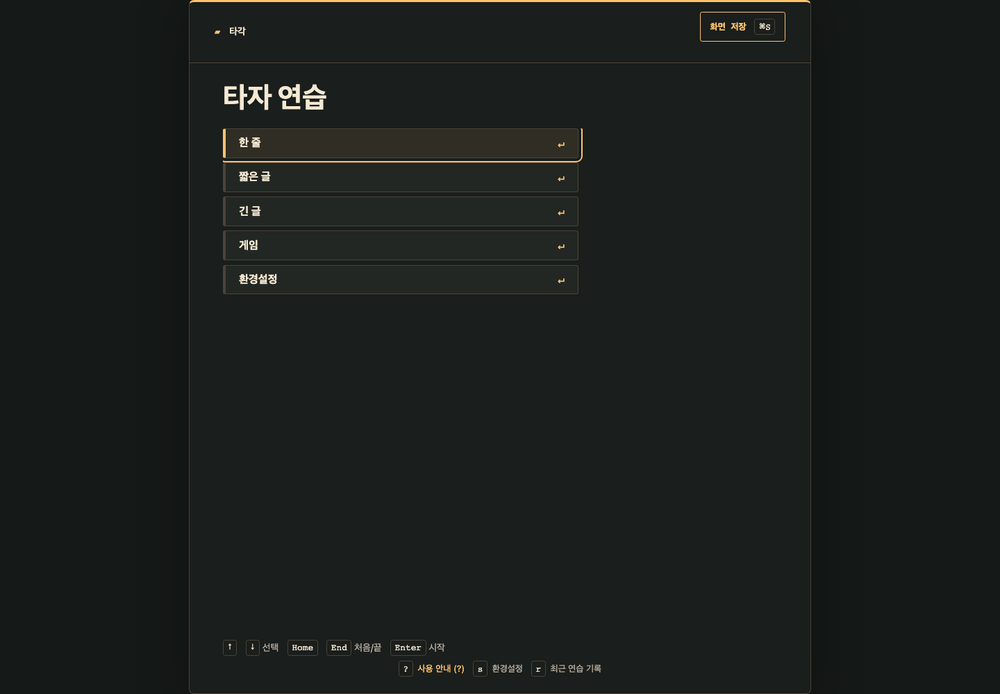

[English](README.md) · [한국어](README.ko.md)

# Tagak · 타각

     

**한메타자교실의 향수를 담은, 간결한 키보드 중심 타자 연습 앱입니다.** 한글과 영어를 오프라인으로 연습하고 기록은 기기에 보관하세요. 한국어 낱말 게임도 즐길 수 있습니다.

[최신 릴리즈 다운로드](https://github.com/SaehwanPark/tagak/releases/latest) · [설치와 데이터 안내](docs/USER-GUIDE.md)

**지원 플랫폼:** Windows 11 (x64) · macOS 14+ (Apple Silicon)

- 한글·영어 한 줄, 짧은 글, 긴 글 연습
- 30초 한국어 낱말 도전과 베네치아 낱말 게임
- 기기에 저장하는 세션 통계와 하이스코어
- 14개 색상 테마와 한글·영어 글꼴 설정
- 계정·원격 측정·온라인 순위 없이 오프라인 사용

  
  
  

실제 앱 화면을 캡처한 이미지이며 목업이 아닙니다.

**더 알아보기:** [사용 안내](docs/USER-GUIDE.md) · [개발 안내](docs/DEVELOPMENT.md) · [변경 이력](CHANGELOG.md) · [라이선스와 출처](RIGHTS.md)
