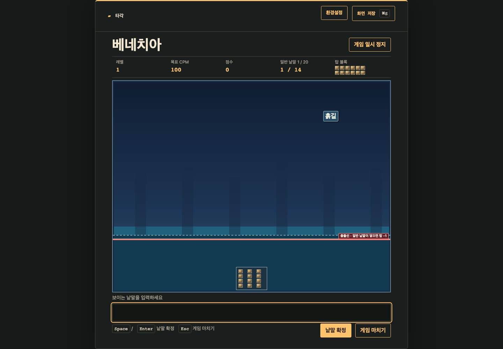
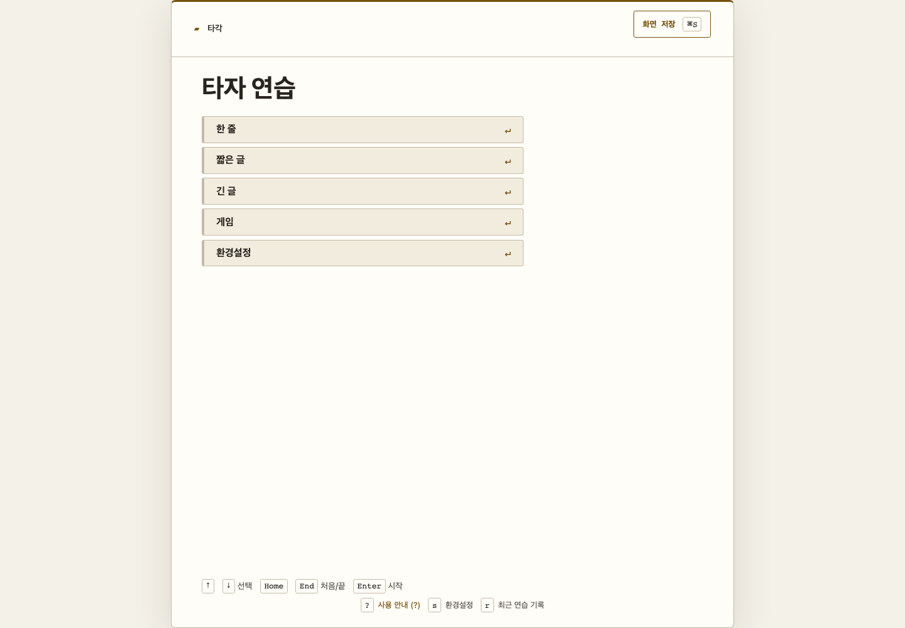
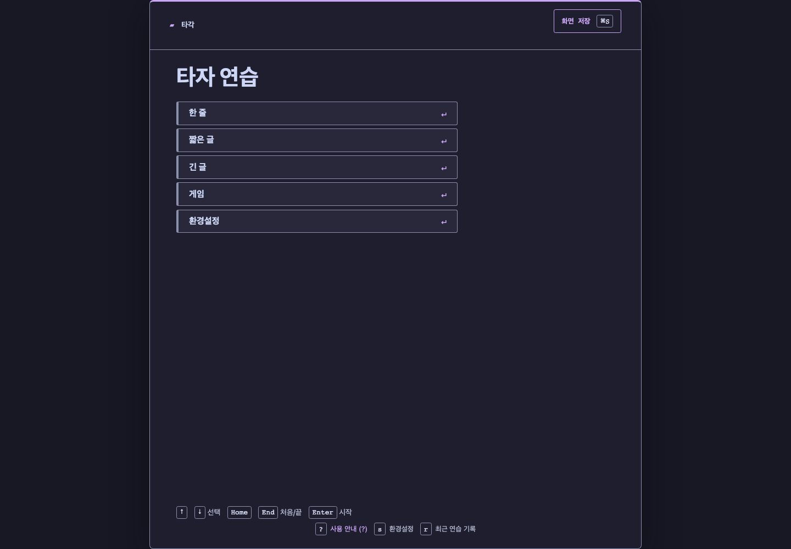
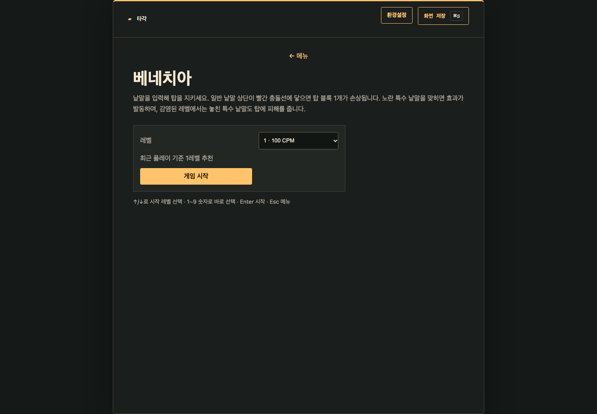

# 타각 (Tagak)

**한글을 매일 편하게 연습하는 오프라인 타자 앱.** 타각(Tagak)은 한 줄 연습, 짧은 글·긴 글, 30초 낱말 도전, 베네치아 게임을 제공합니다. 키보드 중심으로 설계했고 기록과 설정은 이 기기에 저장합니다.

## 다운로드와 지원 OS

| 플랫폼 | 상태 | 다운로드 |
| --- | --- | --- |
| macOS 14+ · Apple Silicon | 기준 데스크톱 환경 | [GitHub Releases](https://github.com/SaehwanPark/tagak/releases) |
| Windows 11 · x64 | 데스크톱 앱 흐름 확인 | [GitHub Releases](https://github.com/SaehwanPark/tagak/releases) |
| Intel Mac | 이번 배포 대상 아님 | — |
| Linux 데스크톱 앱 | 지원하지 않음 | — |

최신 설치 파일은 GitHub Releases에서 받을 수 있습니다. macOS 앱은 Apple Silicon DMG, Windows 앱은 x64 per-user NSIS 설치 파일로 배포합니다. 서명·공증 상태와 SHA-256 체크섬은 각 릴리즈 페이지에 표시합니다.

## 빠른 시작

1. 위 Releases 페이지에서 사용 중인 OS의 설치 파일을 받습니다.
2. macOS에서는 DMG를 열어 앱을 응용 프로그램 폴더에 복사합니다. Windows에서는 설치 파일을 실행하면 현재 사용자 계정에 설치됩니다.
3. 앱을 열고 `한 줄`을 선택합니다. 처음에는 환경설정에서 5문장 세션으로 시작해도 됩니다.
4. 지문을 끝까지 입력하고 `Enter` 또는 `Space`를 눌러 제출합니다. 한글 입력은 평소 사용하는 OS 한글 입력기를 그대로 사용합니다.

`?`는 홈의 사용 안내, `s`는 환경설정, `r`은 최근 기록을 엽니다. 화면 PNG 저장은 macOS `⌘S`, Windows `Ctrl+S` 또는 화면의 저장 버튼으로 시작합니다.

타각은 계정·서버·공개 순위·원격 측정을 사용하지 않으며, 설치 후 오프라인에서 실행됩니다. 환경설정과 연습 기록은 앱의 로컬 저장소에만 남습니다. 기기를 바꾸거나 앱을 다시 설치하기 전에 환경설정의 **데이터 백업·가져오기**에서 JSON 백업을 저장하세요. 업데이트는 새 설치 파일을 받아 설치하는 방식이며, 같은 앱 ID와 저장소를 유지합니다.

현재 버전은 `v1.0.0`입니다. 개발 기준 환경은 **macOS 14+ Apple Silicon Tauri 앱(WebKit)** 이며 Windows 11 x64 Tauri 앱도 설치·오프라인 실행·한국어 IME·저장 흐름을 확인했습니다. 상세 증거와 미확인 범위는 [플랫폼 검증표](docs/PLATFORM-VERIFICATION.md)를 참고하세요.

## 화면 미리보기

아래 이미지는 앱 화면을 브라우저에서 실제 렌더링해 캡처한 것입니다. 합성 목업이 아닙니다.

| 홈 · 터미널 야간 | 한 줄 연습 |
| --- | --- |
|  |  |

| 베네치아 게임 | 종이 밝음 테마 |
| --- | --- |
|  |  |

| 카푸치노 모카 테마 | 베네치아 준비 화면 |
| --- | --- |
|  |  |

## 기능 둘러보기

홈 메뉴는 `한 줄`, `짧은 글`, `긴 글`, `게임`, `환경설정` 순서로 열립니다. 최근 기록과 백업·가져오기는 환경설정에서 엽니다. 홈의 `사용 안내 (?)` 버튼이나 `?` 키로 선택형 키보드 도움말을 열 수 있습니다. 도움말에서는 한글 IME 제출, 작은 세션 시작, 게임 레벨 선택을 안내합니다.

| 메뉴 | 내용 |
| --- | --- |
| 한 줄 | 한글·영문 각각 100문장을 매 시작마다 섞어 연습합니다. 문장 수는 설정에서 5·10·20·30·50·75·100개로 고릅니다. 제시문은 4어절 이상이며 연습 언어의 문자와 공백으로 정리됩니다. 세션 결과에서 이상치를 제외한 평균·표준편차·중간값과 P25–P75 속도 범위를 보고, 자격을 갖춘 세션은 설정한 기준에 따라 하이스코어에 반영합니다. 타각이 직접 쓴 문장과 전승된 격언·속담을 섞어 연습합니다. 격언·속담의 참고 출처는 제시문 아래에서 확인할 수 있습니다. |
| 짧은 글 | 문학·비문학·기술·생활·서브컬쳐 장르의 글을 5줄 묶음으로 읽으며 한 줄씩 입력합니다. |
| 긴 글 | 같은 방식으로 더 긴 글을 연습합니다. |
| 게임 | 하위 메뉴에서 30초 낱말 도전 또는 베네치아를 고릅니다. 두 게임은 한글 낱말을 사용합니다. |
| 환경설정 | 언어·속도 단위·글자 크기·14개 테마·글꼴·효과음을 바꾸고, 최근 연습 기록·데이터 백업·가져오기·오프라인 저작권 및 제3자 고지를 엽니다. |

기존 버전에서 저장했거나 백업으로 가져온 자리·낱말 기록도 최근 연습 기록에서 확인할 수 있습니다. 해당 연습을 새로 시작하는 메뉴는 제공하지 않습니다.

짧은 글·긴 글은 한국어 45편(짧은 글 36 · 긴 글 9), 영어 23편(짧은 글 16 · 긴 글 7)으로 총 68편입니다.

베네치아에서는 준비 화면에서 CPM 목표가 표시된 시작 레벨을 직접 고르거나 최근 5회 실적에 기반한 추천을 사용합니다. 일반 낱말 20개를 처리하면 다음 레벨로 올라가고, 14레벨은 계속 점수를 쌓습니다. 한 게임에서 이미 나온 낱말은 해당 레벨의 후보를 모두 쓸 때까지 다시 나오지 않습니다. 일반 낱말 상단이 빨간 충돌선에 닿으면 탑 블록 하나가 손상됩니다. 보이는 낱말을 입력한 뒤 `Space` 또는 `Enter`로 확정하며, 설정·탭 이탈·창 비활성화 중에는 게임이 멈춥니다. 효과음은 환경설정 토글을 따르고 기본은 꺼져 있습니다.

베네치아는 고전 DOS 게임 분위기에서 영감을 얻은 비공식 타각판 재구성입니다. 원작 실행 파일·이미지·폰트·사운드·단어 데이터베이스는 포함하지 않습니다.

그 밖의 기능:

- **화면 저장** — 머리글의 버튼이나 macOS `⌘S` 또는 Windows `Ctrl+S`로 현재 화면을 PNG로 저장합니다. 데스크톱 앱은 경로를 묻고 브라우저는 다운로드합니다.
- **다국어 UI** — 인터페이스 언어(한국어/영어)와 연습 언어를 따로 고릅니다. 영어 연습에서는 영문 한 줄·글 자료를 사용하며 게임은 계속 열 수 있습니다.
- **읽기 편의 설정** — 글자 크기 3단계, 다크 10개·라이트 4개의 색상 테마, 언어별 `고딕`·`명조` 글꼴. 테마는 좌우 순환하거나 목록에서 바로 고를 수 있습니다. 색상 참고 출처와 라이선스는 [테마 크레딧](docs/THEME-CREDITS.md)에 있습니다.
- **효과음** — 기본은 꺼짐입니다. 켜면 연습 단위 완료음과 베네치아의 입력·정답·피격·종료음을 재생합니다.

## 연습 방식과 점수

- 한 줄·글의 각 줄은 **끝까지 입력한 뒤 `Enter` 또는 `Space`** 로 제출합니다. 미완성 상태의 `Space`는 입력 중인 공백으로 남습니다.
- 한 줄 연습은 설정한 문장 수(5·10·20·30·50·75·100개)를 매번 섞어 진행합니다. ‘연습 마치기’로 먼저 끝내도 완료한 문장 속도로 통계를 계산합니다. 각 문장의 연습 기록은 계속 개별 저장됩니다.
- 한 줄 제시문은 4어절 이상이며, 한국어는 한글 문자, 영어는 라틴 문자만 남기고 문장부호·숫자·기호를 제거해 공백을 정리합니다.
- 한 줄·짧은 글·긴 글 결과에는 제출한 줄의 속도로 평균·모집단 표준편차·중간값·P25–P75 범위를 계산해 표시합니다. 20줄 이하 세션은 유효 표본이 3개 이상일 때 최고·최저를 하나씩 제외하고, 20줄을 넘으면 양 끝 5%씩 제외합니다. 통계는 현재 표시 속도 단위를 따릅니다.
- 정상 완료한 세션은 모드와 연습 언어별로 저장하며, 한 줄은 설정한 세션 문장 수도 구분합니다. 전체 입력 정확도가 97% 이상이고 유효 속도 표본이 5개 이상인 세션만 하이스코어 대상입니다. 첫 대상 세션은 등록되고, 기존 기록은 원시 CPM 중간값이 0.3% 이상 높으며 단측 Mann–Whitney 검정에서 `p < 0.05`일 때 갱신합니다. 짧은 글·긴 글은 조기 종료해도 완료한 줄이 있으면 세션 결과와 이력에 남지만 하이스코어에는 반영하지 않습니다.
- 결과 화면은 첫 기록이면 이번 중간값과 속도 단위를, 비교 기록이 있으면 이번·기존 중간값과 부호가 있는 변화율을 먼저 보여줍니다. 갱신하지 못하면 실제 정확도·유효 표본 수·조기 종료 여부 또는 통계 기준을 설명합니다. `하이스코어 판정 기준` 상세 정보는 p값과 기준을 보여주고 Mann–Whitney가 타각의 기록 안정성 규칙이며 실제 실력 향상을 증명하지 않는다는 한계를 안내합니다. 속도는 선택한 단위로 소수 첫째 자리까지 표시하고 판정은 반올림 전 원시 값으로 합니다. 판정 계산이 실패해도 완료 세션은 저장하고 기존 최고 기록을 유지하며, 저장 오류와 구분해 알립니다.
- 하이스코어는 최근 100회 세션 이력과 별도로 유지되며, 기록 화면에서 최고 기록만 초기화하거나 전체 기록·세션·최고 기록을 함께 지울 수 있습니다.
- 한글 IME 조합을 `Space`로 끝내면, 남은 제시문이 있으면 공백 하나를 넣고 입력이 끝났으면 같은 `Space`로 제출합니다. 조합에 쓴 `Enter`/`Space`가 제출까지 실행하지 않도록 이벤트를 구분합니다.
- 연습 중에는 **정확도만** 실시간으로 갱신됩니다. **속도는 연습 단위가 끝날 때** 보고합니다. 한 줄은 제출 시, 짧은 글·긴 글은 5줄 묶음이 끝날 때입니다. 30초 낱말 도전은 속도를 보고하지 않습니다.
- **한국어 CPM(분당 타수)** 은 완성 글자 수가 아니라 두벌식 타수로 셉니다. `한`은 3타, 쌍자음은 1타, 이중모음·겹받침은 2타, 공백·문장부호는 각각 1타입니다. 정확도는 글자 기준으로 따로 계산합니다.
- **영어 WPM(분당 단어 수)** 은 분당 글자 수를 5로 나눈 값입니다. 두 언어의 표시 단위는 환경설정에서 바꿀 수 있습니다.
- **짧은 글·긴 글의 시간**은 각 줄의 첫 확정 입력부터 제출까지를 합산합니다. 줄을 제출한 뒤 다음 줄의 첫 입력 전까지의 전환·적응 시간은 속도에 넣지 않습니다.
- 한 줄·짧은 글·긴 글은 환경설정이 열린 시간과 앱 창이 비활성 상태인 시간을 타수 계산에서 제외합니다. 입력하지 않고 생각하거나 읽는 시간은 포함합니다. 30초 낱말 도전도 환경설정이나 앱 창 비활성 상태에서 멈추고, 돌아오면 남은 시간부터 이어집니다.
- 경과 시간이 1초 미만이면 속도를 `—`로 표시합니다.

## 키보드 조작

| 화면 | 조작 |
| --- | --- |
| 홈 | `?` 도움말 · 데스크톱 앱에서 `Esc` 앱 종료 · 브라우저에서는 `Esc`로 종료하지 않음 |
| 메뉴·목록 | `↑` `↓` 이동 · `Home` `End` 처음/끝 · `Enter` 선택 · `Esc` 뒤로 |
| 환경설정 | `↑` `↓` 항목 이동 · `←` `→` 또는 `Enter`/`Space` 값 변경 · `Esc` 돌아가기 |
| 연습 | `Enter`/`Space` 제출 · 진행한 세션의 `Esc`/뒤로는 확인 후 종료, 취소하면 현재 입력 복구 |
| 결과 | `Enter` 다시 연습 · `Esc` 돌아가기 |
| 읽기 전용 긴 콘텐츠 | 포커스 후 `↑` `↓` 한 줄 · `PageUp` `PageDown` 화면 단위 · `Home` `End` 처음/끝 |
| 입력란 바깥 | `s` 환경설정 · `r` 최근 연습 기록 |
| 어디서나 | macOS `⌘S` · Windows/Linux `Ctrl+S` 화면 PNG 저장 |

`s`/`r`/`?` 바로 가기는 편집 가능한 요소에 초점이 있거나 한글 IME 조합 중, 키 반복 입력 중에는 동작하지 않습니다. `Tab`/`Shift+Tab`으로 버튼·입력창·읽기 전용 스크롤 영역을 옮길 수 있습니다. 다른 탭이나 창에서 돌아오면 마지막으로 사용한 앱 컨트롤로 초점이 돌아옵니다.

## 브라우저 대체 실행

타각은 설치 후 오프라인에서 실행됩니다. 웹 브라우저에서 소스를 실행하는 방법과 데스크톱 앱 빌드 도구는 [개발 안내](docs/DEVELOPMENT.md)에 있습니다.

## 검증 범위

macOS 14+ Apple Silicon Tauri 앱이 기준 환경입니다. Windows 11 x64 Tauri 앱도 기존 설치·오프라인 실행·한국어 IME·저장 흐름을 확인했습니다. Intel Mac과 Linux 데스크톱 앱은 이번 배포 대상이 아니며, 브라우저별 보조 확인은 전체 OS 지원 선언과 구분합니다. 날짜별 실행 환경과 미확인 항목은 [플랫폼 검증표](docs/PLATFORM-VERIFICATION.md)에 있습니다.

## 내 데이터는 어디에 있나

- 브라우저의 설정과 최근 연습 기록·세션·하이스코어, 베네치아 최근 30회와 Top 10은 해당 브라우저 프로필의 `localStorage`에 저장됩니다. Tauri 앱은 고정된 앱 ID와 플랫폼 웹뷰 저장소를 사용합니다. 두 저장소 모두 로컬이며 서버로 보내지 않습니다.
- 앱 업데이트로 저장 키 이름이 바뀌어도 같은 주소(origin)에서는 기존 설정과 기록을 자동으로 이전합니다. 배포 주소가 바뀌면 브라우저 저장소가 분리되어 자동 이전되지 않습니다.
- Tauri 앱은 브라우저와 별도의 플랫폼 웹뷰 저장소를 사용합니다. 환경설정의 `데이터 백업·가져오기`에서 설정과 저장된 기록·세션·하이스코어를 JSON으로 옮길 수 있습니다. 형식·버전을 검증하고, 기존 데이터가 있으면 병합·전체 교체·취소를 선택합니다. 지원되지 않거나 손상된 파일은 적용하지 않습니다. 입력 중인 원문은 저장하거나 백업에 포함하지 않습니다.
- macOS 14+ Tauri 앱은 A31, Windows 11 Tauri 앱은 A32에서 검증했습니다. 로컬 빌드는 각 OS에서 `npm run desktop:build` 또는 `npm run desktop:build:windows`로 만들며, 사용자용 설치 파일은 아직 게시하지 않았습니다.
- 기존 줄별 연습 기록과 최근 100회 세션을 보존합니다. 하이스코어는 모드·언어별(한 줄은 세션 문장 수별)로 별도 유지합니다. 기록 화면에서 최고 기록만 초기화하거나 전체 기록을 지울 수 있습니다.
- 연습 중 입력 원문은 저장하지 않습니다. 화면 PNG는 사용자가 저장을 요청했을 때만 만들어집니다.
- 브라우저 저장소를 지우면 설정과 기록도 함께 사라집니다.

## 개발자

저장소에서 개발·검증·데스크톱 패키지를 만드는 방법은 [개발 안내](docs/DEVELOPMENT.md)를 참고하세요.

## 프로젝트 문서

- [RIGHTS.md](RIGHTS.md) — 프로젝트 소프트웨어 권리 상태와 사용 허가
- [ARCHITECTURE.md](ARCHITECTURE.md) — 구조, 데이터 흐름, 핵심 규칙(개발자용)
- [TEXT-LICENSES.md](TEXT-LICENSES.md) — 연습문별 출처·라이선스와 추가 절차
- [CHANGELOG.md](CHANGELOG.md) — 버전별 변경 이력
- [docs/PROJECT-SPEC.md](docs/PROJECT-SPEC.md) — 제품 범위, 화면 흐름, 기술 결정
- [docs/SPEC.md](docs/SPEC.md) — 실행 체크리스트와 구현 상태
- [docs/PLATFORM-VERIFICATION.md](docs/PLATFORM-VERIFICATION.md) — OS·브라우저별 검증 기록
- [AGENTS.md](AGENTS.md) — 저장소 작업 지침과 PR 흐름

화면과 연습 흐름은 [온라인 타자교실](https://typing.zidell.me/)과 [에듀베이지 소개](https://www.edubeige.com/post/typing-zidell)를 참고했습니다.

## 연습 자료 출처

전승 표현의 참고 출처는 제시문 아래에 작게 표시하고, 링크를 선택하면 새 탭에서 자료를 엽니다. 현대 작품의 대사는 별도 이용 허가가 확인되지 않으면 연습문에 넣지 않습니다. 글의 저자·출처·라이선스는 글 고르기 목록에 표시합니다. 글별 저자·출처·라이선스·발췌 및 표시 변경 사항은 [TEXT-LICENSES.md](TEXT-LICENSES.md)와 설치본의 환경설정에서 여는 오프라인 제3자 고지에서 확인할 수 있습니다.

- [한국어 위키문헌](https://ko.wikisource.org/) · [영어 위키문헌](https://en.wikisource.org/) — CC BY-SA 4.0, 원문은 저작권 만료 작품
- [한국어 위키백과](https://ko.wikipedia.org/) · [영어 위키백과](https://en.wikipedia.org/) — CC BY-SA 4.0
- 대한민국헌법 전문 — 저작권법 제7조에 따라 보호받지 않는 저작물 ([국가법령정보센터](https://www.law.go.kr/lsLinkCommonInfo.do?chrClsCd=010202&lsJoLnkSeq=1029423769))
- 그 밖의 원문 — 직접 작성, `license: "original"`

`TEXT-LICENSES.md`는 콘텐츠 애셋에서 자동 생성됩니다. 애셋을 바꾼 뒤 `npm run text-licenses:update`로 갱신하고, `npm run test`로 애셋 메타데이터와 문서가 일치하는지 확인합니다.
