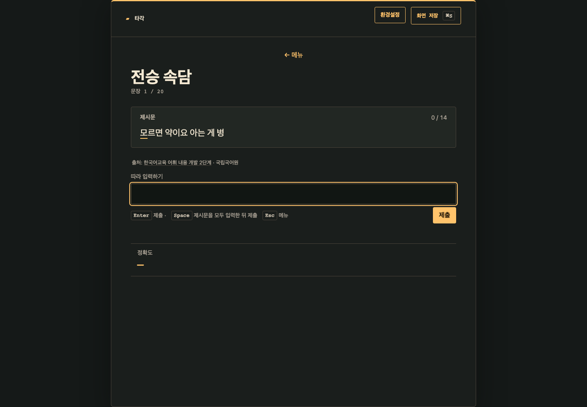
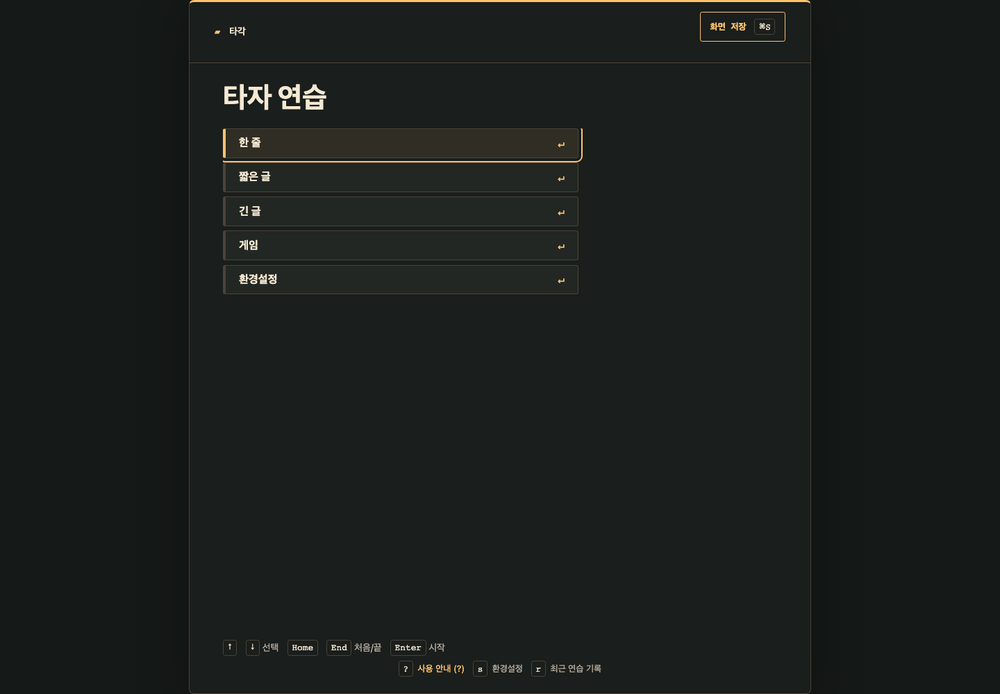

[English](README.md) · [한국어](README.ko.md)

# Tagak · 타각

    

**A minimalist, keyboard-first typing practice app with a touch of nostalgia.** Practice Korean or English offline, keep your records on your device, and take a break with a Korean word game.

[Download the latest release](https://github.com/SaehwanPark/tagak/releases/latest) · [Installation and data guide](docs/USER-GUIDE.md)

**Available for:** Windows 11 (x64) · macOS 14+ (Apple Silicon)

- Practice one-line drills, short passages, and long passages in Korean or English.
- Try a 30-second Korean word challenge or defend your tower in Venice.
- Review session statistics and personal high scores stored on your device.
- Choose from 14 color themes and Korean or English font settings.
- Use the app offline; it has no account, telemetry, or online leaderboard.

  
  
  

Screenshots show real app screens, not mockups.

**More:** [User guide](docs/USER-GUIDE.md) · [Development](docs/DEVELOPMENT.md) · [Changelog](CHANGELOG.md) · [License and credits](RIGHTS.md)
